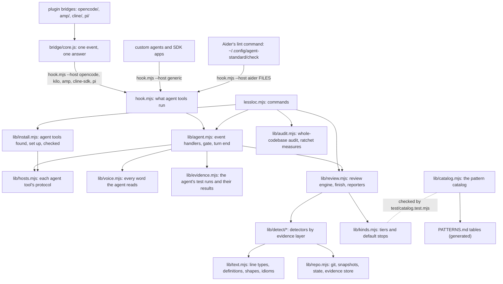
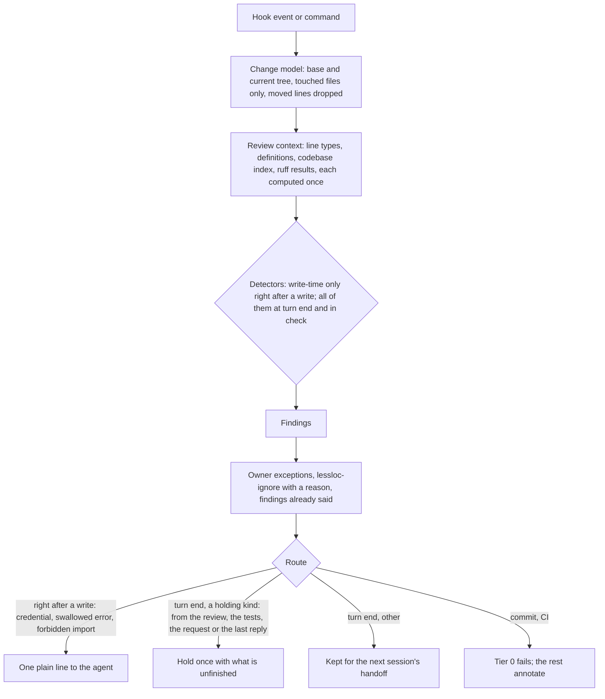

# lessloc architecture

lessloc is a control loop around an AI coding agent. It minimizes how much the next person or agent must read and investigate per correctly finished task: create less, keep information true, make it findable, keep verified knowledge, and keep its own overhead small.

## Modules

| Module | Responsibility |
|---|---|
| `lessloc.mjs` | The command line: `check`, `test`, `verify`, `ci`, `audit`, `find`, `probe`, `baseline`, `doctor`, `init`, `remove`, and `catalog` and `hosts`, which write the generated tables |
| `lib/agent.mjs` | The agent hooks, event by event: what an agent is told, stopped from and asked to finish, and the handoff to the next session. `lint()` is Aider's lint command |
| `lib/repo.mjs` | Git access, the project's `.lessloc.json`, lessloc's state files, snapshots of the working tree, changes, evidence and the definitions index |
| `lib/text.mjs` | Source text without I/O: language tables, line types, definitions with their body shape and literals, clone windows, and the retrieval behind hints |
| `lib/audit.mjs` | The whole-codebase audit, and the measures the ratchet holds |
| `hook.mjs` | The command every agent tool's hooks run. Some tools show it to their model, so its name says nothing more. With `--host aider` it is Aider's lint command: `lint()` in `lib/agent.mjs` reviews the files Aider names and reads no input |
| `augment/hook.sh`, `cursor/hook.sh` | `hook.mjs` for Augment, which runs only script files as hooks, and for Cursor's plugin, whose hook commands run from the plugin's folder |
| `lib/voice.mjs` | Every text an agent reads: the working standard, hints, refusals, write notes, the turn-end hold, the handoff. None names lessloc, shows its paths or commands, tags a kind or cites a source |
| `lib/requirements.mjs` | The names a request asks to exist, from the wording around them, and whether a tree has them anywhere: a file's text, path or name, or a close spelling the change wrote. Also what the agent's last reply says it left failing of the request |
| `lib/evidence.mjs` | Test runs recognized in the agent's shell commands (runner, masked or not, whole suite or a selection), their result as the host reported it, and the files that define what the tests run |
| `lib/hosts.mjs` | Each agent tool's hook protocol as one row: event and tool names in Claude Code's vocabulary, what the tool cannot do (ask the user, take context with a prompt), how it reports a command's success, and how an answer is written back. The `generic` row is the documented protocol for custom agents |
| `lib/install.mjs` | The agent tools on a user's machine: found by program and folder, recognized by the variable each sets for its agent's commands, set up and taken out by `init` and `remove`, and checked by `doctor`, which runs each installed hook command once |
| `.github/plugin/`, `copilot-hooks.json`, `.cursor-plugin/`, `cursor-hooks.json`, `gemini/`, `qwen-extension.json`, `qwen-hooks.json`, `scripts/gemini-extension.mjs` | The plugin manifests and hook files of Copilot CLI and Cursor, the Gemini CLI extension, and Qwen Code's extension manifest and hook file. The release workflow builds the Gemini extension, with Qwen Code's manifest, into each release's one asset. Copilot and Qwen Code find their manifests before Claude Code's, and no hook file sits where Claude Code would load it |
| `bridge/core.js` | What every plugin bridge shares: it runs one event through `hook.mjs --host <tool>` in the generic protocol and returns the answer, failing open |
| `opencode/server.js` | The OpenCode and Kilo Code plugin. One default export carries OpenCode 2.x's `setup` and OpenCode 1.x's `server`; Kilo Code loads the `kilo` export. It applies the answers through each version's permission, tool and session APIs |
| `amp/plugin.js`, `cline/plugin.js`, `pi/extension.js` | The plugins for Amp, the Cline CLI and SDK, and Pi: each maps its tool's events and tool names onto the generic protocol and applies the answer through that tool's plugin API. `init` writes a two-line file in the tool's plugin folder that loads them from the checkout |
| `lib/kinds.mjs` | Every finding kind: its tier, and whether it stops a turn by default |
| `lib/catalog.mjs` | Every pattern: what agents do, the standard that calls it bad, the kinds that report it, and how it is proven handled |
| `lib/detect/index.mjs` | Every detector, cheapest evidence first |
| `lib/detect/lines.mjs` | Write-time: policy, junk files, secrets, comments, line rules, swallowed errors |
| `lib/detect/simpler.mjs` | Write-time: shorter idioms (built in, plus ruff and clippy) |
| `lib/detect/files.mjs` | Turn end, one file at a time: structure, comment weight, imports, churn, tests, dependencies |
| `lib/detect/change.mjs` | Turn end, the change as a whole: safeguards removed, layout, copied tests, docs, untested behavior, growth |
| `lib/detect/codebase.mjs` | Turn end, against the codebase: copies, versions side by side, single implementations, dead code, copied rules and styles, values copied from tests |
| `lib/detect/platform.mjs` | Turn end, against manifests and the platform: undeclared imports, hand-written versions of library features |
| `lib/review.mjs` | Builds the review context once, runs the detectors the moment calls for, then accepts, suppresses, ranks and prints |
| `.claude-plugin/`, `.codex-plugin/`, `codex-hooks.json` | Claude Code's plugin and marketplace manifests, whose hooks run `hook.mjs` with no host flag, and the Codex plugin's manifest and hook file |
| `skills/lessloc/` | The `/lessloc` skill of Claude Code and Codex: setup, audit, review, consolidate, find. Only the user starts it |
| `docs/` | lessloc.org, built with VitePress. `docs/scripts/generate.mjs` makes the pattern pages, the benchmarks page, the why-less-code page and the plain-text install page from the repository |
| `bench/` | The benchmarks ([bench/README.md](bench/README.md)) |

## A review

A detector is `{ id, when: 'write' | 'turn', run(ctx) }`. It reads the change through `ctx` (`live`, `code()`, `typed(c)`, `added(c)`, `defs(c)`, `born(c)`, `fresh()`, `index()`, `ruff()`) and reports with `ctx.put(kind, file, line, message)`. `LESSLOC_PROFILE=1` prints each detector's time.

## Adding an agent tool

1. Add its row to `HOSTS` in `lib/hosts.mjs`. A tool with a plugin API instead of hook commands gets a bridge beside `opencode/server.js` that uses `bridge/core.js`, and a row that is the generic protocol under the tool's own name. List its event and tool names where they differ from Claude Code's, and say whether it can ask the user, whether its prompt hook takes context, where it reports a command's exit code, and how it takes an answer. `fields(raw, event)` renames a payload into Claude Code's field names and shapes, so the core reads no new formats. `variant(raw)` hands the payloads of another runtime that reads the same hook file to that runtime's row (VS Code's through Copilot's). `gate: false` says the tool cannot refuse one call (Cline's hook files can only end the run), so writes are tracked without being judged first. A tool that lacks a channel says which: `start: false` (its session start reaches no model), `feedback: false` (nor does an after-tool hook), `track: 'turn'` (it has no after-tool event), `turnStart: 'stop'` (it has no prompt event), `sessionStart: 'tool'` (it has no session start event, so a session starts with its first call) or `sessionless` (its tool hooks name no session). lessloc then delivers the session start text through the first channel left: the prompt, a pre-tool hook (`preContext`), or a user-level rules file that `rules()` names and `init` writes.
2. Give its row a `hooks` entry (its user-level hook file, the events it hooks, and how an entry and the file are written; `own` when the file is lessloc's alone; `read` when the file keeps its entries other than under `hooks`; `command` when the tool runs something other than `node hook.mjs`). Every hook command names its host: `hook.mjs --host <tool>`. Where the tool's payloads do not name their event, the command names it too: `hook.mjs --host copilot preToolUse`. A plugin or extension of the tool carries a hook file written by the same `hooks` entry, and a test compares the two.
3. Give the tool its entry in `TOOLS` in `lib/install.mjs`: its program, its folder, the variable it sets for its agent's commands, what the user still does after the install, and its row in the status table (`docs`). `init --<tool>`, `init --agents`, `remove` and `doctor` then handle it. Test the install in `test/install.test.mjs`, with a temporary home folder. Run `node lessloc.mjs hosts --write`, which puts the status table into the getting-started guide; `test/install.test.mjs` fails until it matches.
4. Add `test/fixtures/hosts/<tool>.json`: the tool's documented payloads, their sources and the date they were read, and where the tool reads each part of an answer. Mark what the documentation does not show under `_verify`. A plugin bridge's fixture goes in `test/fixtures/bridges/`, with the events its plugin API documents, and `test/bridges.test.mjs` runs it through a fake of that API. Aider's lint command has `test/fixtures/lint/aider.json` instead: what Aider runs, and what it shows its model. `test/adapters.test.mjs` runs every hook fixture through the same scenario: a placeholder is denied, a clean write passes, a policy file and `--no-verify` go to the user, a write note is added without replacing the tool's output, a failed and then a passing test run are recorded (each where the tool gives its hooks a channel for it), the turn is held once, the next session gets the handoff, and nothing the model reads names lessloc.
5. Keep `test/golden.test.mjs` passing. It replays a recorded Claude Code session and requires the same answers and state, byte for byte, so a new row never changes what Claude Code gets.
6. Give it an adapter in `test/e2e/tools.mjs` and a pinned version in `test/e2e/tools.json`: its install route, its tool names, its environment and its headless command, run against the local fake model in `test/e2e/model.mjs`. `E2E_TOOLS=<id> E2E_INSTALL=1 E2E_RECORD=1 npm run e2e` writes a session that passes every check to `test/fixtures/recorded/`, and `npm test` replays it. Until then, its row says "tested against documented payloads". Afterwards, its row says "tested end to end on <version>" for exactly the version recorded, and its section in the getting-started guide says what ran. `test/install.test.mjs` fails on a version no recording ran.

## Adding a pattern

1. Add the catalog row in `lib/catalog.mjs`: the pattern, the standard, and `does` naming its kinds as `{kind}`.
2. Report it from a detector in the layer whose evidence it needs. Use the cheapest layer that can see the problem.
3. Prove it: bad and good forms in `test/cases.mjs`, or a named test. A pattern that cannot be detected names a rule in `RULES.md` instead.
4. A new kind goes in `lib/kinds.mjs` as a note. It may stop turns only once `node bench/replay.mjs <repo>`, on public repositories such as those [bench/README.md](bench/README.md) names, shows that its hits on code humans already merged are almost always real instances of the pattern.
5. Run `node lessloc.mjs catalog --write`. `test/catalog.test.mjs` fails until every pattern is proven, every kind is catalogued, and PATTERNS.md matches.

## State

lessloc writes nothing into a repository by default. Its state lives in `~/.cache/lessloc/<repo>-<id>/`, per user and per checkout:

- session journals and private git indexes;
- evidence, one file per tree;
- handoff records, one file per session;
- the definitions index;
- cost and error logs.

Snapshots are ordinary unreachable git objects. [Files lessloc writes](https://lessloc.org/guide/reference#files-lessloc-writes) lists everything.
